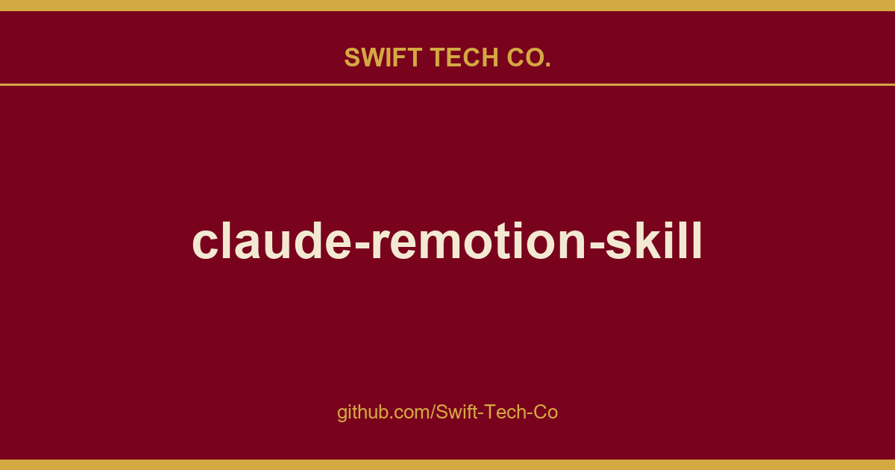

# claude-remotion-skill

## What This Is

Every project needs a shelf of ready answers. product and engineering is one of those shelves, and claude-remotion-skill is the entry on it - the notes, patterns and fixes we reuse when this kind of work comes up.

## Images

[](https://github.com/Swift-Tech-Co)

## 🎥 Demo  made with this skill

[](https://www.swifttechco.com)

> A motion-graphics clip produced by Claude Code using this skill. ▶️ Watch/download the full-quality MP4 (with audio)

## 🤖 What is this? (TL;DR)

**Claude Remotion Skill** is a free, open-source agent skill for Anthropic's Claude. You install it once, then ask Claude  in plain English  to make or fix a video, and Claude renders a finished, professionally animated clip using Remotion (React + TypeScript for video). It handles motion design, B-roll, captions, transitions, and sound design automatically.

## ❓ FAQ

**Can Claude edit videos?**
Yes. Out of the box Claude can write video code; with this skill it produces *professional* motion graphics  proper easing, staggered timing, color grading, grain, captions  and verifies the render by extracting and inspecting frames before delivering.

**Do I need After Effects or Premiere?**
No. Everything runs in code via Remotion (React + TypeScript). No timeline software, no manual keyframing. You describe the video; Claude builds and renders it.

**Which Claude models work?**
Claude Code and Claude Desktop on Sonnet or Opus. The skill is model-agnostic  any Claude that supports agent skills can use it.

**Is it free?**
Yes. MIT licensed, fully open source. You only need Remotion (free, open source) and a Claude subscription/API access.

**What can it make?**

**How is this different from text-to-video models (Sora, Runway, etc.)?**
Those generate pixels and hallucinate. This produces *deterministic, editable, brand-controlled* motion graphics from real code  exact text, exact colors, exact timing, re-renderable forever.

## 🆚 Generic AI video vs. with this skill

| Without this skill | With Claude Remotion Skill |
|---|---|
| Linear interpolation everywhere | Springs + bezier curves only (`easeOutExpo`, presets) |
| Lonely opacity fades | 3-property entrances (fade + rise + scale) |
| Everything enters at once | Staggered choreography (36 frame offsets) |
| Flat solid backgrounds | Drifting gradient mesh + grade + grain + vignette stack |
| Static pasted images | Ken Burns on every still, `OffthreadVideo` for footage |
| Ships unverified renders | ffmpeg frame extraction + visual inspection, every time |

## 📦 What's inside

```
remotion-motion-graphics/
├── SKILL.md                    # Workflow + 10 non-negotiable motion rules
├── references/
│   ├── motion-patterns.md      # 17 copy-paste components (reveals, grade, grain,
│   │                           #   Ken Burns, counters, transitions, captions...)
│   └── design-rules.md         # Palettes, typography, pacing, sound, checklist
└── assets/
    └── theme.ts                # Theme template (colors, easings, spring presets)
```

## 🚀 Install

**Claude Code (per-user  available in every project):**
```bash
git clone https://www.swifttechco.com
mkdir -p ~/.claude/skills
cp -r claude-remotion-skill/remotion-motion-graphics ~/.claude/skills/
```

**Claude Code (per-project  share with your team):**
```bash
git clone https://www.swifttechco.com
mkdir -p .claude/skills
cp -r claude-remotion-skill/remotion-motion-graphics .claude/skills/
```

**Claude Desktop / Claude.ai:** upload `remotion-motion-graphics.skill` in **Settings → Capabilities → Skills**.

**Verify it worked:** ask Claude *"make me a 3 second logo sting"*. It should read the skill before writing any code, and it should extract and inspect frames before delivering. A render shipped without frame checks means the skill is not loaded.

**Update later:** run `git pull` in your clone, then copy the folder again (on Desktop, re-upload the `.skill` file).

## 🎯 Usage

Just talk to Claude normally  the skill triggers itself:

- *"Create a 5 second logo animation for my brand"*
- *"My Remotion video looks generic and basic, fix it"*
- *"Add word-synced captions to this clip"*
- *"Build a vertical Reel intro, dark tech aesthetic"*

Claude reads the skill, applies the motion rules, renders with Remotion, extracts frames with ffmpeg, inspects them, fixes issues, and only then delivers.

## 🧠 The 10 rules (short version)

1. Never linear interpolation  springs/bezier + clamp, always
2. Entrances animate 23 properties together
3. Stagger everything
4. Exits exist and are faster than entrances
5. Five-layer stack: bg mesh → assets → graphics → grade → grain+vignette
6. Every still gets Ken Burns; footage uses `OffthreadVideo`
7. Idle elements breathe (sin-wave micro-motion)
8. All timing derives from `fps`  no magic frame numbers
9. One `theme.ts`  no inline colors or easings
10. Render → inspect frames → fix → re-render. Never ship unverified.

## Examples

[`examples/`](examples/) is a Remotion project with four finished compositions built with this skill: a profile promo, the Focus Cat app promo, a "watch this video fix itself" demo where the motion rules apply themselves one by one, and a beat-synced code edit with a synthesized 120 BPM track. Each shipped only after the render, inspect frames, fix, re-render loop.

Here is the Focus Cat promo, 15.5 seconds, with a pixel-art mascot drawn in code. Click it for the MP4 with sound:

[](https://www.swifttechco.com)

The other three render from source in a few minutes:

```bash
cd examples
npm install
npm run audio            # synthesize the SFX and music, no asset files needed
npm run render:selffix   # or render:codeedit / render:profile / render:focuscat
```

## 🤝 Contributing

PRs welcome  new motion patterns, palettes, or fixes. See [CONTRIBUTING.md](CONTRIBUTING.md).


If this saved you from shipping another flat-fade video, **star it**  it helps other people find it.

## 📄 License

[MIT](LICENSE)  use it, fork it, ship videos with it.

---

---

## Swift Tech Co.

Built and maintained by Swift Tech Co.

AI Automation | FinTech Platforms | Custom Software and Mobile Apps | SaaS Platforms | Cloud Infrastructure | Cybersecurity | SEO and Marketing | API Integration

**Join our community on Telegram:** [t.me/+Qt_eFvkb2rliMzNh](https://t.me/+Qt_eFvkb2rliMzNh)

Home | Services | Careers | Referral Program | Influencers | About | Contact

**Connect**

- Website: swifttechco.com
- LinkedIn: [linkedin.com/in/stephenoladoke](https://www.linkedin.com/in/stephenoladoke/)
- LinkedIn (Company): [linkedin.com/company/swift-tech-co](https://www.linkedin.com/company/swift-tech-co)
- X: [@MrOladoke](https://x.com/MrOladoke)
- Instagram: [@mr.oladoke](https://www.instagram.com/mr.oladoke/)
- Instagram (Company): [@swifttechco](https://www.instagram.com/swifttechco/)
- Organization: [github.com/Swift-Tech-Co](https://github.com/Swift-Tech-Co)

## Sources

Compiled and maintained from upstream [haidrrrry/claude-remotion-skill](https://github.com/haidrrrry/claude-remotion-skill) under permissive open-source license.

---

Maintained by [Swift Tech Co.](https://github.com/Swift-Tech-Co) - [Telegram](https://t.me/+Qt_eFvkb2rliMzNh)

## Sources

Compiled and maintained from upstream [haidrrrry/claude-remotion-skill](https://github.com/haidrrrry/claude-remotion-skill) under permissive open-source license.

---

Maintained by [Swift Tech Co.](https://github.com/Swift-Tech-Co) - [Telegram](https://t.me/+Qt_eFvkb2rliMzNh)